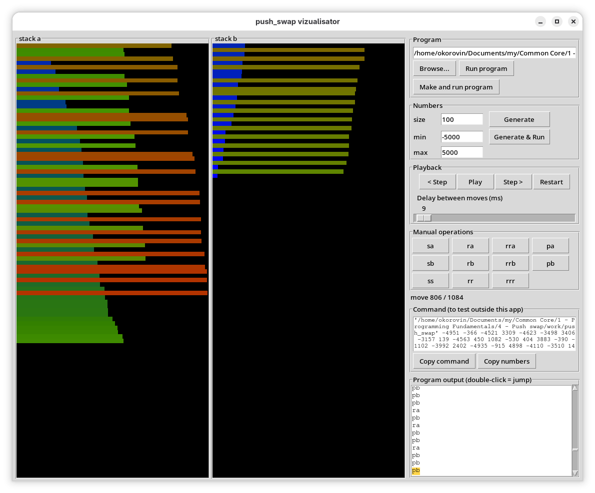

# push_swap vizualisator

A small Tkinter application to visualise your solution of the **push_swap** project
from [École 42](https://42.fr). It runs your `push_swap` program on random numbers
and animates the result: two stacks drawn as coloured bars, the list of
instructions printed by your program, and a ready-to-copy command line so you can
reproduce any test outside the application.



## About the push_swap project

push_swap is an algorithm project of the École 42 curriculum. Given a list of
distinct integers placed in stack **a**, with an empty stack **b** next to it, the
goal is to sort stack **a** in ascending order (smallest number on top) using only
a small set of instructions (swap, push, rotate and reverse rotate), and to print
the shortest possible list of instructions. Fewer moves means a better grade, so
being able to *see* what your algorithm does with 5, 100 or 500 numbers is very
useful for debugging and for improving it.

## Credits

This project is based on the idea of
[hex01e/push_swap_simulator](https://github.com/hex01e/push_swap_simulator).

## Requirements

- Python 3.8 or newer
- Tkinter (usually bundled with Python)

On Debian/Ubuntu, if `import tkinter` fails:

```sh
sudo apt install python3-tk
```

No other Python packages are needed.

## Usage

```sh
python3 viz.py [path/to/push_swap]
# or, after chmod +x viz.py
./viz.py [path/to/push_swap]
```

The program path is optional: you can also choose it from the GUI (**Browse...**).
A path given on the command line overrides the one saved from the previous session.

## Interface

### Stacks

Two framed canvases, **stack a** and **stack b**, show each stack from top (first
row) to bottom. Bar length and colour depend on the value (blue for the smallest
numbers, through green and yellow, to red for the largest). The same value keeps
the same colour wherever it is. The window is resizable and the bars scale with it.

### Right-hand panel

| Section | What it does |
| --- | --- |
| **Program** | Path of the `push_swap` program. **Browse...** opens a file dialog, **Run program** (or Enter in the field) launches the program on the current numbers and enables playback. **Make and run program** first runs `make -C <folder of the program>` (needs a Makefile there), then runs the program. |
| **Numbers** | `size`, `min` and `max` of the random sequence. **Generate** only creates `size` distinct numbers between `min` and `max` (inclusive) and shows them in stack a; the program is not run. **Generate & Run** does both in one click: new numbers, then the program is run on them. |
| **Playback** | **< Step** / **Step >** go one instruction back / forward, **Play** / **Pause** animates the sort, **Restart** returns to the initial state. The slider sets the delay between two moves (0 to 500 ms). |
| **Manual operations** | Buttons for `sa sb ss ra rb rr rra rrb rrr pa pb` to play with the stacks by hand. |
| **Status line** | Current move out of the total, and **SORTED** / **NOT SORTED** once the last instruction has been applied. Errors are shown in red below it. |
| **Command** | The exact command line for the current numbers, e.g. `./push_swap 12 -5 300 ...`. **Copy command** copies the whole line, **Copy numbers** copies only the numbers. |
| **Program output** | Every instruction printed by the program, one per line. The instruction currently applied is highlighted. **Double-click a line** to jump to that point of the sort. Unknown instructions and anything written on stderr are shown in red. |

**Run program** is disabled while the selected program does not exist or is not executable.
The playback buttons are also disabled until the program has been run on the current
numbers: generating new numbers disables them again until you press **Run program**. The application re-checks this every second,
so they are enabled as soon as the file appears (for example after `make`).

## How your program is run

- **Make and run program** runs `make` (default target) in the program's folder, with a 120 second limit. If make fails, its output is shown in the output list in red and nothing is run.
- Each **Run program** starts a fresh process, so a recompiled binary
  is picked up automatically. Nothing is compiled by the viewer.
- The numbers are passed as separate command-line arguments, exactly as shown in the
  **Command** box.
- The program must print one instruction per line on stdout. Recognised instructions:
  `sa sb ss pa pb ra rb rr rra rrb rrr`.
- A file ending in `.py` is run with the same Python interpreter as the viewer.
- The program is stopped if it takes longer than 12 seconds.
- A non-zero exit code or text on stderr is reported in the GUI.

## Saved settings

On every Generate / Run program and when the window is closed, the following are
written to `~/.push_swap_viz.json`:

- program path
- `size`, `min`, `max`
- delay slider value
- the last generated numbers

At the next start they are restored, so you get the same sequence back (press
**Run program** to play it again). Click **Generate** for a new one. Delete the file to reset everything to the defaults
(size 30, min -5000, max 5000, delay 50 ms).

## Notes and limitations

- Manual operations change the stacks but not the progress of the loaded program;
  **Restart**, **< Step** or a double-click in the output list rebuilds the state from
  the program's instructions.
- With a delay below 5 ms several instructions are applied per screen refresh to
  keep long sorts fast.
- The window size is not saved between sessions.
- Very large sequences (several thousand numbers) draw bars smaller than one pixel
  and can make the animation slow.

## Troubleshooting

| Problem | Fix |
| --- | --- |
| `ModuleNotFoundError: No module named 'tkinter'` | Install Tk support (`sudo apt install python3-tk`). |
| Make and run program is greyed out | There is no `Makefile` in the folder of the program path. |
| Run program / Generate & Run are greyed out | The path is empty, wrong, or the file is not executable (`chmod +x`). |
| Playback buttons are greyed out | Press **Run program** (they are disabled after Generate and until the program has run successfully). |
| "Program timed out after 12s" | Your program is too slow or stuck for that input size. |
| "NOT SORTED" | Your instruction list does not sort the numbers; check the highlighted moves in the output list. |
| Wrong settings keep coming back | Delete `~/.push_swap_viz.json`. |

## License

MIT. See [LICENSE](LICENSE).